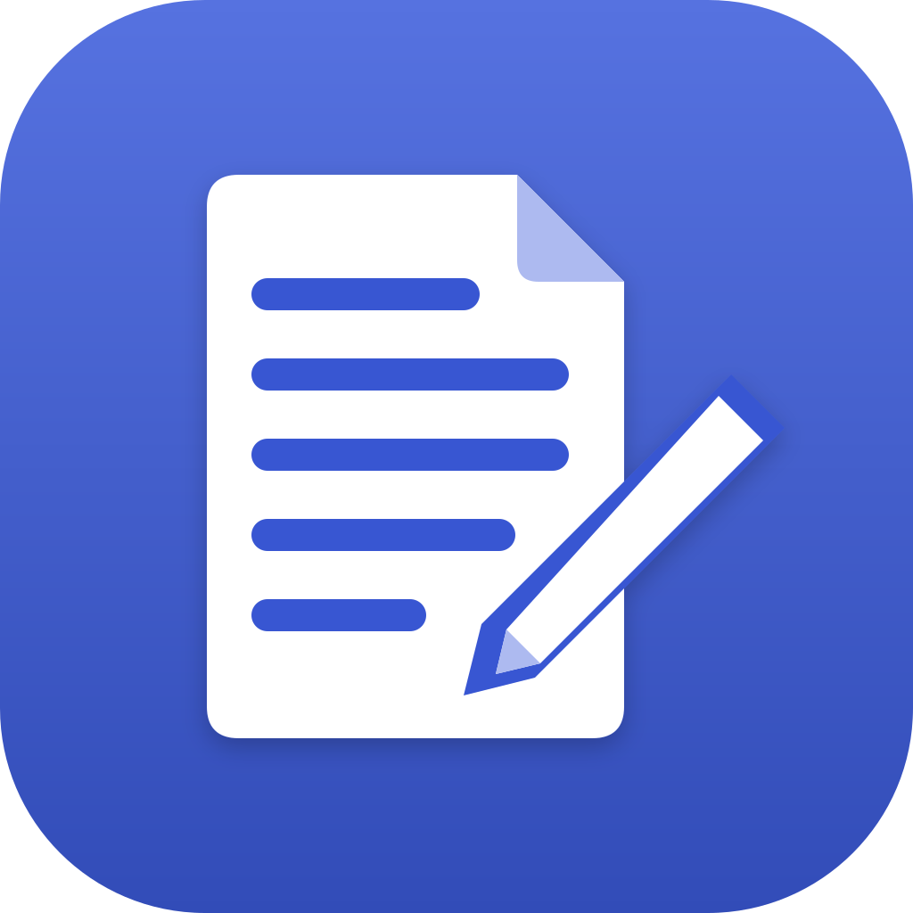

<h1 align="center">NERDS Word</h1>

<b>Writing and document design.</b> Part of the NerdsCraft Suite: install it with
<a href="https://github.com/nerds-coach/nerds-launcher/releases/latest">NERDS Launcher</a>.

NERDS Word is [WordCraft](https://github.com/storytold/wordcraft), ArtCraft's free and open-source app, as a NERDS
edition: the NERDS icon, and NERDS names throughout (NERDS Word in its windows, menus, About box and
installer, NERDS Craft as its publisher). This repository holds no app code: its
[build workflow](.github/workflows/build.yml) takes each official WordCraft release, makes those changes,
builds it for Windows and macOS on GitHub, and publishes it under [Releases](../../releases) with the
same version and file names. It checks for a new release every six hours.

What the build changes:

- `app-icon/`: the NERDS icon, laid over the app's own `assets/app-icon/`.
- `.github/nerds-rename.py`: the names. It changes the words people read and leaves identifiers
  alone (data folders, file formats, registry keys, the bundle id), so settings and documents keep
  working. `nerds.json` holds this app's own settings for it. Each build lists every change in
  `names.txt` on the `ci-output/windows` and `ci-output/macos` branches.
- `dmg/background.svg`: the Mac disk image's window.

The app's code and its license (MIT OR Apache-2.0) are WordCraft's: see
[storytold/wordcraft](https://github.com/storytold/wordcraft). The NERDS icon and logos are NERDS brand assets.

To build now: **Actions → Build → Run workflow** (tick *force* to rebuild a version already here).
